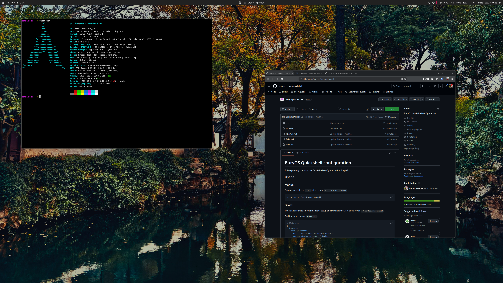

# BuryOS Quickshell configuration

This repository contains the Quickshell configuration for BuryOS.



## Usage

### Manual

Copy or symlink the `./src` directory to `~/.config/quickshell`:

```bash
cp -r ./src ~/.config/quickshell
```

### NixOS

The flake assumes a home manager setup and symlinks the ./src directory as `~/.config/quickshell`.

Add the input to your `flake.nix`:

```nix
# flake.nix
{
  inputs = {
    bury-quickshell = {
      url = "github:bury-os/bury-quickshell";
      inputs.nixpkgs.follows = "nixpkgs";
    };
  };
}
```

Import bury-quickshell in your home manager config:

```nix
# home.nix
{
  imports = [
    inputs.bury-quickshell.homeManagerModules.default
  ];
}
```